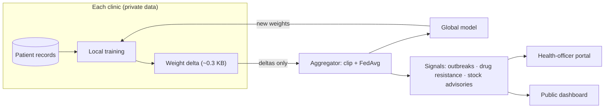

# Delta Network — Privacy-First Federated Healthcare Intelligence

Neighbourhood clinics hold data that could power outbreak detection and decision support, but privacy law and
breach risk stop them from pooling it. **Delta Network moves the model to the data instead**: each clinic trains
locally and shares only a tiny weight *delta*; a central aggregator averages the deltas (FedAvg) into a global
model that every clinic benefits from — and turns the network-wide signal into outbreak alerts, drug-resistance
warnings, and pharmacy stock advisories.

> **Demo data is 100% synthetic.** No real patient data is used anywhere in this repository.

## Features

| Area | What it does |
|---|---|
| **Federated learning** | Local training → delta extraction → outlier clipping → sample-weighted FedAvg → global model. Optional Gaussian noise on deltas. |
| **Two role-gated portals** | *Clinic portal*: patient entry, CSV import, train & submit delta, AI assistant, treatment logging. *Health-officer portal*: aggregation control, outbreak map, drug-efficacy tracker, stock advisory. |
| **Explainable AI assistant** | Risk score from the global logistic-regression model with an *exact* per-feature breakdown, confidence, and cross-network cohort stats. |
| **Differential diagnosis** | Transparent rule-based symptom matching (Dengue, Chikungunya, Typhoid, Malaria, viral fever) with test/management suggestions — no drug doses. |
| **Outbreak detection** | Per-clinic spike detection vs. a 7-day baseline, plus regional clustering of simultaneous spikes within 10 km (haversine). Live Leaflet map. |
| **Drug-resistance signal** | Flags a treatment failing for the same condition across *multiple* clinics — a pattern no single clinic can see. |
| **Stock advisory** | Turns spikes + logged conditions into disease-specific supply recommendations, plus week-over-week demand trends. |
| **Public dashboard** | `/public` — no login, aggregate-only data for press, other officials and pharmacies. |

## Architecture



**Privacy invariant:** a `DeltaSubmission` row holds a weight vector and summary stats — never a patient row.
Every patient query is scoped by the caller's `clinic_id`, and a test asserts one clinic can never read another's
records. Public endpoints return only clinic-level aggregates.

## Tech stack

FastAPI · SQLAlchemy 2 · **PostgreSQL 16** · Pydantic v2 · JWT auth (PyJWT, PBKDF2 password hashing) · NumPy ·
Jinja2 + Tailwind + Chart.js + Leaflet · **Docker / Docker Compose** · Caddy (auto-HTTPS) · pytest · GitHub Actions

## Quick start (Docker)

```bash
cp .env.example .env          # Windows: copy .env.example .env
# edit .env: set POSTGRES_PASSWORD and DELTA_HEALTH_SECRET  (generate with:
#   python -c "import secrets; print(secrets.token_hex(32))")
docker compose up --build
```

Open <http://localhost:8000> (interactive API docs at `/docs`, health probe at `/health`).
With `SEED_DEMO_DATA=true` the first start creates demo clinics, backdated patient history, and a warm-started model.

| Portal | Username | Password |
|---|---|---|
| Clinic 1–4 | `clinic1` … `clinic4` | `clinic123` |
| Health officer | `healthofficer` | `admin123` |

Reset everything: `docker compose down -v` (deletes the database volume).

## Local development (no Docker, SQLite)

```bash
cd backend
python -m venv venv && source venv/bin/activate        # Windows: venv\Scripts\activate
pip install -r requirements.txt -r requirements-dev.txt
python seed.py
uvicorn app.main:app --reload
```

## Tests

```bash
cd backend && pytest -v
```

Covers: FedAvg / clipping / DP-noise maths, explainable-prediction correctness, config that fails closed in
production, authentication and server-side role enforcement, patient-data isolation between clinics, CSV import
validation, a full federated round, regional outbreak detection, the multi-clinic drug-failure rule, and the public
API's privacy. CI runs the suite against a real PostgreSQL service and builds the Docker image on every push.

## Deployment

*Free-tier terms below were checked in Oct 2026 and change often — verify before relying on them.*

**Option A — Render (Docker web service) + Neon (Postgres). Free, about 20 minutes.**
1. Neon: create a project, copy the connection string (keep `sslmode=require`).
2. Push this repo to GitHub. Render → *New → Web Service* → pick the repo → Runtime **Docker**, Root Directory `backend`.
3. Environment variables:
   `DELTA_HEALTH_ENV=production`, `DELTA_HEALTH_SECRET=<64 random hex chars>`, `DATABASE_URL=<neon url>`, `SEED_DEMO_DATA=true`.
4. Set the health-check path to `/health`.

Notes: Render's free web service sleeps after ~15 min idle (first request then takes about a minute); Neon's free
compute also scales to zero when idle. Don't use Render's own free Postgres for a long-lived portfolio project —
it expires after 30 days.

**Option B — a VPS or AWS EC2 with Docker Compose and automatic HTTPS (shows more DevOps).**
```bash
# on the server, with a domain whose DNS A record points at it and ports 80/443 open
git clone <your-repo> && cd delta-health
cp .env.example .env     # set secrets, DELTA_HEALTH_ENV=production, DOMAIN=your.domain
docker compose -f docker-compose.yml -f docker-compose.prod.yml up -d --build
```
Caddy obtains and renews the TLS certificate automatically. If using AWS, note new accounts now get a
credits-based free plan that is time-limited — set a billing alarm.

> A deployment with `SEED_DEMO_DATA=true` publishes the demo logins above. That is intended for a showcase with
> synthetic data; never seed demo credentials on a system holding anything real.

## Suggested demo (3 minutes)

1. `/public` — the district view anyone can see, with no patient data.
2. Sign in as `clinic1` → *Ask Global AI* with Dengue-like symptoms → score, explanation, differential, recommendations.
3. Add 5+ fever patients at `clinic2` and `clinic4` → *Outbreak monitor* → run regional check → alert across nearby clinics.
4. Log the same failing treatment at several clinics → *Drug efficacy* → run check → resistance alert.
5. *Stock advisory* → disease-specific supplies for the spiking clinics.

## API overview

| Prefix | Auth | Purpose |
|---|---|---|
| `POST /auth/login` | none | Issue JWT (role + clinic claims) |
| `/clinic/*` | clinic role | Patients, CSV import, train/submit delta, predict, treatments, alerts, sync status |
| `/admin/*` | admin role | Overview, aggregate, heatmap, timelines, signal checks, stock advisory |
| `/public/*` | none | Aggregate-only district data |
| `GET /health` | none | Liveness/readiness (503 if the database is down) |

## Security notes

- Passwords hashed with PBKDF2-HMAC-SHA256 (260k iterations); JWTs expire after 8 hours.
- Roles are enforced server-side on every endpoint, with tests.
- In production the app **refuses to start** with a default or short signing key.
- Container runs as a non-root user; Postgres is not published to the host (reachable only from the API container); secrets come from the environment.

## Known limitations (deliberate, and what I'd do next)

- **Clinics are simulated inside one deployment.** Training currently runs server-side against each clinic's rows.
  In a real rollout the training step runs on clinic hardware and only the delta crosses the network — the
  aggregation boundary is already designed that way.
- **Weight deltas can leak information.** Gaussian noise is a simplified stand-in for formal differential privacy;
  production would add secure aggregation and a tracked privacy budget (ε, δ).
- **The differential diagnosis is rule-based**, not a trained classifier, because no labelled per-disease data
  exists. It is labelled as decision support in the UI. The *risk score* is the real federated model.
- **Not a medical device** and not HIPAA/DPDP-compliant: no audit log, no BAA, no consent management.
- Schema is created with `create_all`; next step is Alembic migrations.
- JWT lives in `localStorage` (simple, but XSS-sensitive); production would use httpOnly cookies with CSRF protection,
  plus rate limiting on login.

## Project structure

```
delta-health/
├── docker-compose.yml          # PostgreSQL + API
├── docker-compose.prod.yml     # + Caddy (automatic HTTPS)
├── Caddyfile
├── .env.example
├── .github/workflows/ci.yml    # tests on Postgres + docker build
└── backend/
    ├── Dockerfile  bootstrap.py  healthcheck.py  seed.py
    ├── requirements.txt  requirements-dev.txt  pytest.ini
    ├── tests/                  # unit + API tests
    └── app/
        ├── main.py  config.py  database.py  models.py  schemas.py  security.py  deps.py
        ├── fl_core.py          # FedAvg, clipping, DP noise, explainable prediction
        ├── alerts.py  differential.py  stock_advisor.py
        ├── routers/            # auth · clinic · admin · public
        └── templates/          # server-rendered portals
```
